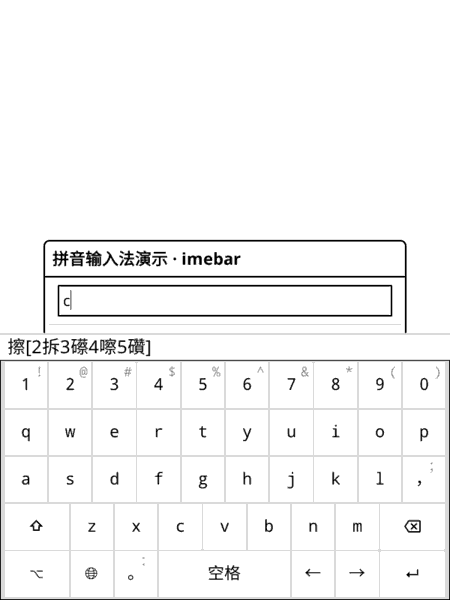

# imebar.koplugin — 拼音辣条 / Candidate bar for KOReader's pinyin keyboard

 

## 中文

软键盘上方一条整宽候选字条，自带一套拼音增强引擎：候选带数字编号、数字选字、←/→ 翻页、模糊拼音、记忆常用词、自定义词组表、v 模式英文直通。

纯插件实现（`package.loaded` 占位接管引擎 + 运行时包裹），**不修改任何系统文件**，删目录即卸载。

### 功能

- **候选字条带**：完整候选串（舞台字 + `[2你 3尼 …]` 编号候选）画在键盘上方的条带里；组合期输入框只显示拼音码，选字提交时覆盖为汉字。长候选不再挤爆单行输入框，行首不被裁掉
- **自带拼音引擎**：`ime_engine.lua` 为内置 `generic_ime` 的补丁副本，加载期占位 `package.loaded`；数字 2-9 + 0 选字、←/→ 翻页、模糊拼音、记忆词、自定义词组、v 模式全部内建，可单独取代 imeplus（同时安装时辣条稳定优先）
- **门控回退**：仅当开关开启、zh_CN 拼音布局、且条带实际显示时接管候选显示；开关关闭 / 非拼音布局 / 全屏输入框（vterm 等）100% 走原生路径，条带 UI 抛错也不影响文字输入
- **记忆常用词（简拼）**：上屏过的词按使用次数前置；完整输入一次 `jiazai`→「加载」后，`jz` 即出。菜单可开关、可清空
- **自定义词组表**：菜单「自定义词组表」内直接编辑；纯中文词自动生成简拼码，网址/英文/中英混合词显式给码（`http://… bd`）。保存后下次开键盘即生效，无需重启
- **模糊拼音**：zh/z、ch/c、sh/s 三对平翘舌（默认开），菜单可逐项开关
- **v 模式**：`v` 开头直出半角英文，`vhello` + 双空格 → `hello`；全角标点自动转半角；回车提交并换行
- **vterm 兼容（v0.5.3）**：暴露 `package.loaded["imebar_api"].setExternalSink` 外部候选出口——vterm 检测到后把辣条候选画进自己的自绘条带位，不叠条、不误发 PTY；EN 布局/关终端时注销

### 安装

拷贝到 `koreader/plugins/imebar.koplugin/` 重启 KOReader；菜单在「软键盘候选条」。

### 兼容

基准 v2025.10 引擎；实测 v2026.07.2（KPW3 / Voyage）；系统引擎版本不符自动回退原生。

## English

A full-width candidate strip above the soft keyboard, with a self-hosted pinyin engine: numbered candidates, digit selection, ←/→ paging, fuzzy pinyin, self-learned words, custom phrase table, and v-mode English passthrough.

Pure plugin (engine takeover via `package.loaded`, runtime wrapping only) — **touches no system files**; delete the folder to uninstall.

### Features

- **Candidate strip**: the full candidate window (staged word + numbered candidates) paints in a strip above the keyboard; the input box shows only raw pinyin while composing and is overwritten with the committed text. Long candidates no longer overflow the one-line input box.
- **Self-hosted engine**: `ime_engine.lua` is a patched copy of the stock `generic_ime`, installed by pre-seeding `package.loaded`; digit select (2-9 + 0), paging, fuzzy pinyin, word memory, custom phrases and v-mode are all built in — can replace imeplus outright (imebar takes priority when both are installed).
- **Gated fallback**: takes over only when enabled, on the zh_CN pinyin layout, with the strip actually shown; otherwise 100% native path. Strip UI errors never break text input.
- **Word memory**: committed words rank by usage count; type `jz` for 加载 after committing it once. Toggle/clear in the menu.
- **Custom phrases**: edited in-menu; pure CJK phrases get auto initials, URLs/mixed words take an explicit code (`http://… bd`). Effective on next keyboard open.
- **Fuzzy pinyin**: the three retroflex/flat pairs (zh/z, ch/c, sh/s) on by default, per-pair toggles in the menu.
- **v-mode**: type `v` first for raw half-width English (`vhello` + double space → `hello`); full-width punctuation is converted; Enter commits and breaks the line.
- **vterm compat (v0.5.3)**: exposes an external candidate sink (`package.loaded["imebar_api"].setExternalSink`) so vterm paints the strip's candidates into its own bar position — no stacked strip, no stray PTY bytes.

### Install

Copy to `koreader/plugins/imebar.koplugin/` and restart KOReader; the menu lives under "imebar".

### Compatibility

Based on the v2025.10 engine; tested on v2026.07.2 (KPW3 / Voyage); falls back to the native path when the stock engine version differs.

## License

AGPL-3.0
